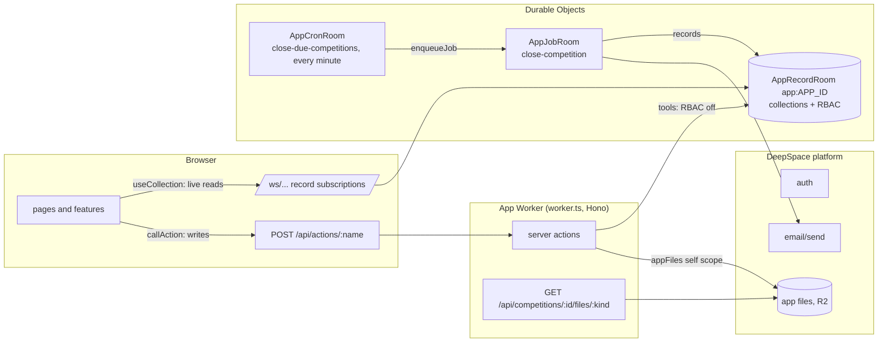
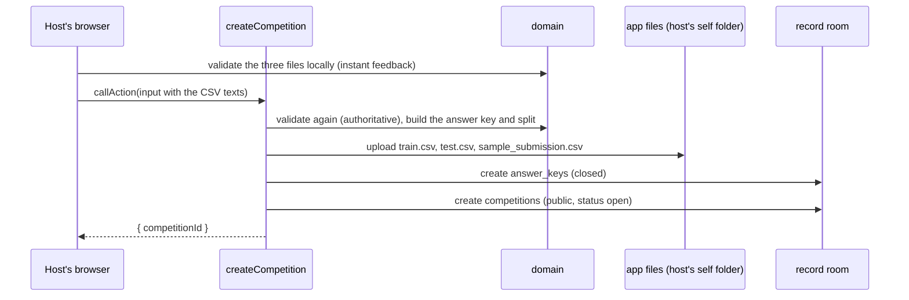
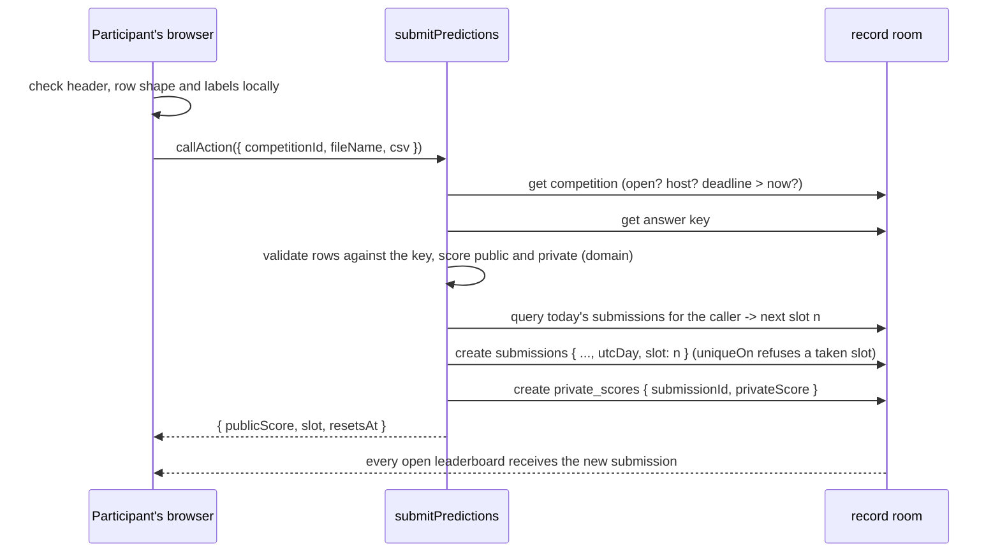

# Architecture

How Holdout is built on DeepSpace: the layers and where files go, the data model and its
permissions, the server actions, the three main flows, the trust model and how
concurrency is handled. The product rules are in [spec.md](spec.md); the reasons for each
choice are in [decisions/](decisions/).

## System



- **Reads** go from the browser straight to the record room over the SDK's WebSocket. The
  room drops every record the caller's role may not read before sending it, so RBAC is the
  read boundary.
- **Writes** go through typed server actions only. No collection grants `create`,
  `update` or `delete` to any client role, so every write passes one validated,
  authorised code path ([ADR 0004](decisions/0004-zod-contracts-instead-of-openapi.md)).
- **Time-driven work** is a cron task that finds due competitions and a job that closes
  each one ([ADR 0009](decisions/0009-close-with-cron-and-a-job.md)).

## Layers and folders

Enforced by ESLint (packages) and dependency-cruiser (directories): `npm run lint`,
`npm run arch`. "Built" marks what exists today; the rest is the plan.

```text
holdout/
├─ worker.ts                 Worker entry (scaffold): route order, Durable Object classes
├─ src/
│  ├─ domain/                Pure TypeScript. No packages, no app imports, no Date.now/Math.random:
│  │  │                      time and seeds are arguments. Runs in both runtimes.
│  │  ├─ csv.ts              RFC 4180 parser: BOM, CRLF, quotes; header lookup; size and row limits
│  │  ├─ dataset.ts          validate train/test/solution; build the answer key; sample submission
│  │  ├─ split.ts            Usage column, or deterministic stratified split by public share
│  │  ├─ predictions.ts      validate a predictions file against an answer key
│  │  ├─ metrics.ts          accuracy, macro-F1, RMSE, MAE; which direction is better
│  │  ├─ scoring.ts          score predictions on the public and the private rows
│  │  ├─ ranking.ts          leaderboard, tie-breaks, auto-selection of finals, shake-up
│  │  ├─ time.ts             UTC day key, daily reset time, deadline checks
│  │  └─ *.test.ts           unit and property tests; metric fixtures checked against scikit-learn
│  ├─ contracts/             Zod contracts shared by both runtimes                         (built)
│  │  ├─ define.ts result.ts action-client.ts schema-drift.ts                             (built)
│  │  ├─ actions.ts          action registry                                              (built, empty)
│  │  ├─ records.ts          record registry                                              (built, empty)
│  │  └─ competitions.ts     record and action schemas for this app
│  ├─ schemas.ts, schemas/   DeepSpace CollectionSchemas: storage columns and RBAC (scaffold location)
│  ├─ actions/               Server actions (Worker)
│  │  ├─ implement.ts records.ts index.ts                                                 (built)
│  │  ├─ create-competition.ts  submit-predictions.ts  update-competition.ts
│  ├─ server/                Hono route registration (scaffold) + files-routes.ts
│  ├─ cron.ts                close-due-competitions task
│  ├─ jobs.ts                close-competition job
│  ├─ client/                Browser glue: callAction, useCollection                       (built)
│  ├─ features/              Browser features, one folder each: components + hooks
│  │  ├─ competitions/       list rows, header, countdown, edit form
│  │  ├─ create/             host form, file drop with local validation
│  │  ├─ submit/             drop zone, local check, my submissions
│  │  └─ leaderboard/        live table, final standings with shake-up
│  ├─ components/ui/         Base UI primitives kit (scaffold, restyled by the theme)
│  ├─ components/            App chrome: Navigation, ErrorScreen, Seo (scaffold, Navigation rewritten)
│  ├─ pages/                 Routes (generouted, file-based)
│  │  ├─ index.tsx           /            static landing, prerendered
│  │  ├─ (app)/home.tsx      /home        competition list
│  │  ├─ (app)/c/[id].tsx    /c/:id       competition page, public
│  │  └─ (app)/(protected)/host/new.tsx  /host/new   create form, sign-in required
│  └─ themes.css, themes.ts  the Holdout theme
├─ scripts/                  design-gate.ts                                                 (built)
├─ tests/                    Playwright specs run by `npx deepspace test run`
└─ docs/
```

Rules an agent should not have to guess:

- Domain code is plain functions over plain data. A function that can reject its input
  returns `{ ok: true, value } | { ok: false, issues }` (its own type in
  `src/domain/result.ts`) and never throws for bad input; actions map that to a contract
  failure.
- A feature folder may import `src/client`, `src/contracts`, `src/domain` and
  `@/components/ui`; never `src/actions`, `src/server` or `deepspace/worker`.
- An action file exports one handler built with `implement(contract, handler)` and is
  registered in `src/actions/index.ts`.
- Pages stay thin: they read route params, pick a feature component and handle the
  not-found state.

## Data model

One record room, `app:<APP_ID>`, holds every collection; each row carries its
`competitionId` ([ADR 0005](decisions/0005-one-room-roles-as-row-data.md)). Times are
epoch milliseconds in `number` columns (not the SDK's `datetime`, which is seconds).

### Permissions

"Public" below means `{ read: true, create: false, update: false, delete: false }` for
`'*'` (signed out), `viewer`, `member` and `admin`. "Closed" means all four `false` for all
four roles, including `admin`, so not even the app owner's browser receives the rows
([ADR 0006](decisions/0006-answer-key-in-a-server-only-collection.md)).

| Collection        | Read                                | Written by                       | Unique on                                    |
| ----------------- | ----------------------------------- | -------------------------------- | -------------------------------------------- |
| `competitions`    | Public                              | create/update actions, close job | (record id)                                  |
| `answer_keys`     | Closed                              | create action                    | `competitionId`                              |
| `submissions`     | Public                              | submit action                    | `competitionId, participantId, utcDay, slot` |
| `private_scores`  | Closed                              | submit action                    | `submissionId`                               |
| `final_standings` | Public                              | close job                        | `competitionId, participantId`               |
| `users`           | Scaffold rules (own row; admin all) | platform                         |                                              |
| `settings`        | Scaffold rules (admin only)         | admin                            |                                              |

### Columns

`competitions` (record id: generated)

| Column                                  | Type (storage / meaning) | Notes                                                  |
| --------------------------------------- | ------------------------ | ------------------------------------------------------ |
| `title`                                 | text                     | required, max 80                                       |
| `summary`                               | text                     | required, max 200                                      |
| `description`                           | text                     | max 5,000                                              |
| `taskType`                              | text, select             | `classification`, `regression`; immutable              |
| `metric`                                | text, select             | `accuracy`, `macro_f1`, `rmse`, `mae`; immutable       |
| `idColumn`, `targetColumn`              | text                     | immutable                                              |
| `labels`                                | text, json               | `string[]` for classification, `null` for regression   |
| `deadline`                              | number                   | epoch ms                                               |
| `dailyLimit`                            | number                   | 1 to 20                                                |
| `scoreDecimals`                         | number                   | 2 to 6                                                 |
| `testRows`, `publicRows`, `privateRows` | number                   | counts only; which rows are public stays secret        |
| `status`                                | text, select             | `open`, `closing`, `closed`                            |
| `closingStartedAt`, `closedAt`          | number                   | epoch ms or null                                       |
| `hostId`                                | text                     | required, immutable                                    |
| `hostName`                              | text                     | display name at creation                               |
| `files`                                 | text, json               | `{ train, test, sample }`, each `{ key, name, bytes }` |

`answer_keys` (record id = `competitionId`)

| Column          | Type       | Notes                                                                       |
| --------------- | ---------- | --------------------------------------------------------------------------- |
| `competitionId` | text       | required, immutable                                                         |
| `rows`          | text, json | `[id, target, split][]`, split `public`/`private`/`ignored`; at most 1.5 MB |
| `rowCount`      | number     |                                                                             |

`submissions` (record id: generated)

| Column            | Type   | Notes                                                                                                    |
| ----------------- | ------ | -------------------------------------------------------------------------------------------------------- |
| `competitionId`   | text   | required, immutable                                                                                      |
| `participantId`   | text   | required, immutable. Set by the server, so no `userBound`                                                |
| `participantName` | text   | signed-out visitors cannot read the user directory                                                       |
| `fileName`        | text   | max 120                                                                                                  |
| `utcDay`          | text   | `YYYY-MM-DD`                                                                                             |
| `slot`            | number | 1 to `dailyLimit`: the daily-limit claim ([ADR 0008](decisions/0008-daily-limit-with-uniqueon-slots.md)) |
| `publicScore`     | number | unrounded                                                                                                |
| `rowCount`        | number |                                                                                                          |

`private_scores` (record id = `submissionId`): `submissionId`, `competitionId`,
`participantId`, `privateScore`.

`final_standings` (record id = `competitionId:participantId`): `competitionId`,
`participantId`, `participantName`, `rank`, `finalScore`, `publicRank`, `publicScore`,
`submissionCount`, `chosen` (json: `{ submissionId, publicScore, privateScore }[]`).

Each collection has a Zod contract in `src/contracts/` and a `CollectionSchema` in
`src/schemas/`; `schema-drift.test.ts` fails when they disagree.

## Server actions

All are `POST /api/actions/<name>` with a JWT, built with `implement()`: input validated,
output stripped to the contract. Failure codes come from `src/contracts/result.ts`.

| Action              | Input                                                                                                                                                                              | Output                                                      | Failures                                                                                           |
| ------------------- | ---------------------------------------------------------------------------------------------------------------------------------------------------------------------------------- | ----------------------------------------------------------- | -------------------------------------------------------------------------------------------------- |
| `createCompetition` | `title, summary, description, taskType, metric, idColumn, targetColumn, deadline, dailyLimit, scoreDecimals, publicShare, files: { train, test, solution }` (each `{ name, csv }`) | `{ competitionId }`                                         | `invalid_input`, `invalid_file` (+ issues), `internal`                                             |
| `submitPredictions` | `competitionId, fileName, csv`                                                                                                                                                     | `{ submissionId, publicScore, slot, dailyLimit, resetsAt }` | `not_found`, `forbidden` (host), `closed`, `limit_reached`, `invalid_file`, `conflict`, `internal` |
| `updateCompetition` | `competitionId` and any of `title, summary, description, deadline`                                                                                                                 | `{ competitionId }`                                         | `not_found`, `forbidden` (not host), `closed`, `invalid_input` (earlier deadline)                  |

One custom route: `GET /api/competitions/:id/files/:kind` (`train`, `test`, `sample`)
streams the dataset from the host's private file folder; public, cacheable, 404 for an
unknown competition or kind ([ADR 0011](decisions/0011-datasets-in-host-files-behind-a-route.md)).

## Flows

### Create



The competition record is written last, so a failure part-way leaves no visible
competition (an orphaned answer key or file is harmless and is listed in
[plan.md](plan.md) as a cleanup task).

### Submit



- The browser cannot check IDs (it does not have the answer key), so it checks shape,
  header and labels only; the server reports missing and unknown IDs.
- Validation and scoring happen before the slot is claimed, so an invalid file never uses
  a slot. If two submissions race for slot `n`, `uniqueOn` refuses one; the action
  recounts once and takes `n + 1`, or answers `limit_reached`, or `conflict` after a second
  collision ([ADR 0008](decisions/0008-daily-limit-with-uniqueon-slots.md)).
- If `private_scores` fails after `submissions` succeeded, the action deletes the
  submission and answers `internal`, so no public score exists without its private one.

### Close

```mermaid
sequenceDiagram
  participant C as cron (every minute)
  participant R as record room
  participant J as close-competition job
  participant M as email/send
  C->>R: query competitions with status open (and closing older than 10 minutes)
  C->>C: keep those with deadline <= now
  C->>R: set status closing, closingStartedAt
  C->>J: enqueueJob('close-competition', { competitionId })
  J->>R: read competition; stop if closed
  J->>R: read submissions and private_scores (paged)
  J->>J: ranking.finalStandings() (domain)
  J->>R: upsert final_standings in chunks (ctx.continue between chunks)
  J->>R: set status closed, closedAt
  J->>M: one email: host in "to", participants in "bcc"
```

Every step can run twice without harm: standings have deterministic ids, the job stops on
a closed competition, and the email is sent only by the run that sets `closed`.

## Trust model

| Threat                                                     | Defence                                                                                                                                |
| ---------------------------------------------------------- | -------------------------------------------------------------------------------------------------------------------------------------- |
| A participant reads the answer key or private scores       | Closed collections: the room never sends those rows to any role. Spec'd by a Playwright test over the record hooks and the agent tools |
| An action leaks a secret field in its response             | `implement()` parses output against the contract, which drops undeclared keys                                                          |
| A client writes a score, a submission or a competition     | No client role has create, update or delete on any app collection                                                                      |
| A caller acts on a competition they do not own             | Actions run with RBAC off, so each one checks `hostId` against the verified `userId` before writing                                    |
| The host submits to their own competition                  | `submitPredictions` refuses with `forbidden`                                                                                           |
| Probing the public leaderboard                             | Daily limit; final ranking on private rows; scores shown at the host's decimals                                                        |
| Someone overwrites a dataset file                          | Files live in the host's `self` folder, which only the host and the Worker can write (`app` scope lets any member overwrite: spike S3) |
| A member triggers the close task or enqueues the job early | The JobRoom refuses every client write (spike S7); the task and the job re-check `deadline <= now`, so an early run does nothing       |
| Spending the owner's credits                               | The only paid call is one email per closed competition, sent by the job                                                                |

Identity comes only from the verified JWT (`ctx.userId`); no action takes a user id from
its input.

## Time

- The server's clock decides: `Date.now()` in actions, cron and jobs, passed into domain
  functions as `now`.
- The daily limit uses the UTC day (`utcDay(now)`), resetting at 00:00 UTC.
- Deadlines are stored as epoch ms. The browser shows them in the viewer's time zone with
  the UTC time on hover.

## Limits and failure modes

| Limit                  | Value                                          | Where it is enforced                  |
| ---------------------- | ---------------------------------------------- | ------------------------------------- |
| Answer key record      | 1.5 MB of JSON (UTF-8 bytes), 50,000 rows      | domain validation, before any write   |
| Action request body    | under 10 MB (train 5 + test 2 + solution 1.5)  | contracts (`max` on each CSV string)  |
| App file allocation    | 1.0 GiB shown for this app (docs: 128 MiB)     | platform (`storage_quota_exceeded`)   |
| Records per query      | no cap from action tools: 5,000 rows, 1.97 MB  | explicit `limit` and `offset` in code |
| Worker CPU per request | not documented; a submission needs 35 to 46 ms | to see on the deployed app (S2)       |
| Leaderboard snapshot   | about 390 bytes per submission, in one frame   | spec limit of 5,000 submissions       |

The day-1 spikes measured these ([lessons](lessons.md#2026-11-19-day-1-spikes-s1-to-s8)).
Local `workerd` enforces none of the platform's limits, so the 2 MB row limit, the CPU
limit, the subrequest limit and the WebSocket message size are confirmed only once they
have been seen on the deployed app; each keeps its fallback in
[plan.md](plan.md#de-risking-spikes-day-1) until then.
